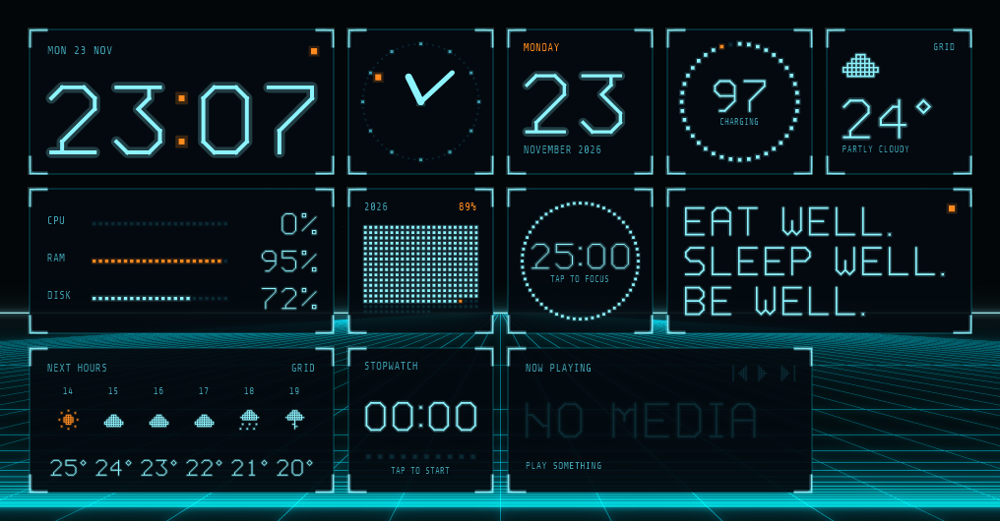
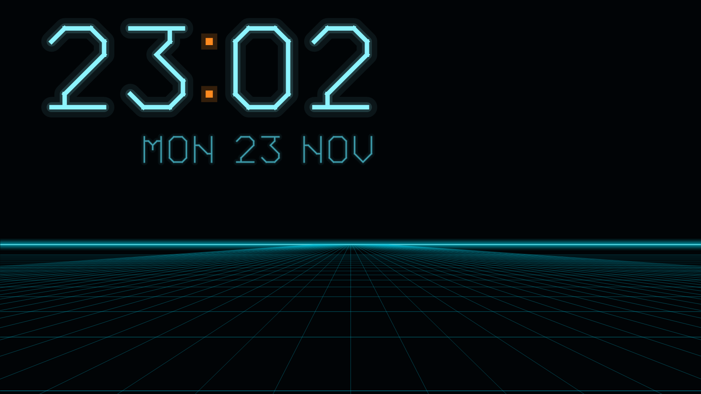
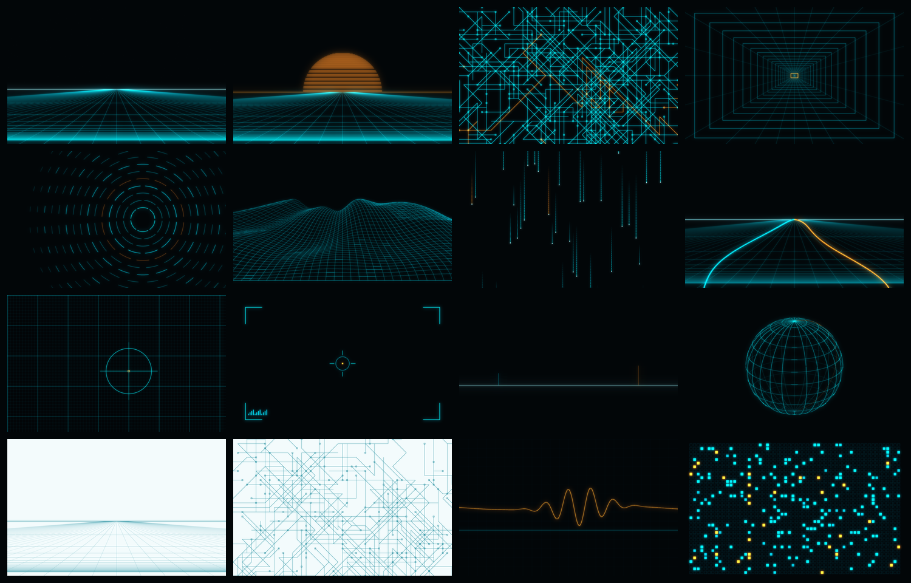
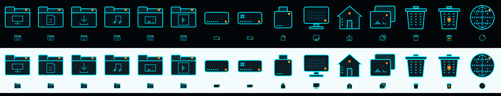
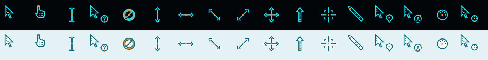
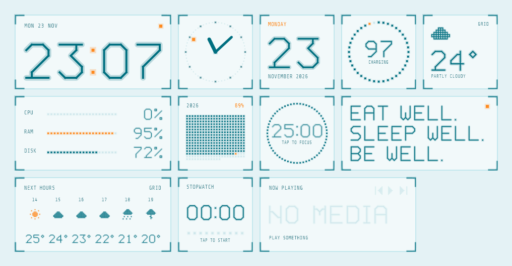

# Gridline OS for Windows

A neon-grid look for **Windows 11**, built on [Windhawk](https://windhawk.net): near-black
surfaces, thin glowing **cyan** lines, an **orange** second accent, sci‑fi type, light-line desktop
widgets, circuit-trace icons, cursors, synth sounds and animations, all switchable on and off and
fully reversible.

> Independent project. Every icon, cursor, sound, wallpaper and widget here was made for it, and
> the fonts are open-licence fonts from Google Fonts.



## What you get

| Area | What changes |
|---|---|
| **Taskbar** | Centered floating dock with a thin cyan edge, Orbitron clock and battery %, line tray icons, cyan running indicators, orange progress bars |
| **Start menu & search** | Near-black panel, Orbitron headings, Share Tech Mono app names, Recommended hidden; search results with mono text, outlined filter pills and an orange selection mark |
| **Quick Settings & notifications** | Near-black panels, circuit-line tile icons, Share Tech Mono text, Orbitron notification titles |
| **File Explorer & Settings** | Share Tech Mono text, dark menus and tooltips, cyan selection and orange progress bars |
| **Window frames** | Near-black title bars with pale cyan titles and a thin cyan border |
| **Desktop widgets** | Clock, analog, calendar, battery, weather, hourly forecast, CPU/RAM/disk, focus timer, stopwatch, Now Playing, year grid, daily quotes and a **Pulse light** that flashes a corner bracket on notifications |
| **Icons** | Dark panels with cyan outlines for folders, Desktop/Documents/Downloads/Music/Pictures/Videos, This PC, Home, Gallery, Network, Recycle Bin and drives |
| **Cursors** | Gridline Pointer — *Carbon* (dark, cyan outline) or *Clear* (light) |
| **Sounds** | Synth UI tones: rising blips, sweeps and a power-up on unlock |
| **Extras** | Light-line clock screensaver over a moving floor grid, 16 neon wallpapers, cyan accent colour, light/dark switch, on/off switch |
| **Animations** *(optional)* | Swell minimize/restore, Cyber Glitch close, quick Alt+Tab |

<p>
  <br>
  <br>
  <br>
  <br>
  
</p>

## Requirements

- Windows 11 (developed on 24H2/25H2 and an Insider build; Windows 10 is not supported)
- [Windhawk](https://windhawk.net) 1.5 or newer — installed, or portable run as administrator
- English Windows display language works best (some Quick Settings icons and the Pulse light match English labels)

## Install

1. **Install Windhawk** and, from its **Explore** tab, these mods:
   - [Windows 11 Taskbar Styler](https://windhawk.net/mods/windows-11-taskbar-styler)
   - [Windows 11 Start Menu Styler](https://windhawk.net/mods/windows-11-start-menu-styler)
   - [Windows 11 Notification Center Styler](https://windhawk.net/mods/windows-11-notification-center-styler)
   - [Windows 11 File Explorer Styler](https://windhawk.net/mods/windows-11-file-explorer-styler)
   - [Windows 11 Settings Styler](https://windhawk.net/mods/windows-11-settings-styler)
   - Optional: [Windows Animations](https://windhawk.net/mods/windows-animations),
     [Taskbar Dock Animation](https://windhawk.net/mods/taskbar-dock-animation),
     [Dark mode context menus](https://windhawk.net/mods/dark-menus)
2. **Add the two mods from this repo** — in Windhawk click **Create a New Mod**, replace the code
   with the file's contents, **Compile Mod**, **Exit editing mode**:
   - `mods/gridline-desktop.wh.cpp` — desktop widgets and Pulse light
   - `mods/gridline-window-frames.wh.cpp` — near-black title bars and cyan borders
3. **Download this repo** (Code → Download ZIP), unzip it, open PowerShell in the folder and run:
   ```powershell
   powershell -ExecutionPolicy Bypass -File .\install.ps1
   ```
   Approve the administrator prompts (fonts and icons are system‑wide). Add `-Light` for the
   light version, or skip parts with e.g. `-Skip Sounds,Screensaver`.

The installer finishes with a checklist of any Windhawk mods still missing. After adding them, run
`scripts\apply-themes.ps1`.

**Prefer to set themes by hand?** Open a styler mod in Windhawk → **Advanced** → *Mod settings*,
replace the contents with the matching file from `themes/` (`.json`, or `.yaml` if your Windhawk
shows YAML) and **Save**.

## Everyday use

| Do this | How |
|---|---|
| Switch dark ↔ light | Desktop shortcut **Gridline Light-Dark**, or `scripts\gridline-mode.ps1` |
| Turn everything off / on | Shortcuts **Gridline - Off / On**, or `scripts\gridline-power.ps1 -Off` / `-On` |
| Change a widget | Windhawk → *Gridline Desktop* → Settings (weather location, quote, theme, accent, which widgets) |
| Move widgets | Drag them; right‑click for *Reset widget layout*, *Refresh weather*, *Test Pulse light* |
| Hear the sounds | `scripts\test-sounds.ps1` |
| Different accent | `scripts\set-accent.ps1 -Color "#FF8A1F"` (orange) — default is cyan `#00E5FF` |
| Light cursors | `scripts\install-cursors.ps1 -Style clear` |

## Uninstall

```powershell
powershell -ExecutionPolicy Bypass -File .\uninstall.ps1            # keep fonts
powershell -ExecutionPolicy Bypass -File .\uninstall.ps1 -RemoveFonts
```
This disables the mods and restores your previous cursors, sounds, screensaver, icons and accent
from `%LOCALAPPDATA%\Gridline-Windows\backup`. Remove the mods themselves in Windhawk.

## Known limitations

- **File list in File Explorer** is classic Windows UI that no styler can reach; it stays Windows dark.
- **Apps with their own title bar** (browsers, Electron apps) keep it; they still get the cyan border.
- **Window animations** (Windows Animations mod) run inside each app, so they only appear in apps
  opened *after* Windhawk loaded. Reopen apps that were already running, and run Windhawk as
  administrator so apps started as admin are covered too. Maximize always uses Windows' own
  animation, and packaged system apps (Settings, Store, Photos) and `mmc` consoles keep the
  native transitions.
- **Cursors and sounds** — Windows' theme service resets cursors and the sound scheme after unlock
  or a light/dark switch; the *Keep Gridline cursors and sounds* option in *Gridline Desktop* puts
  yours back automatically.
- **Quick Settings tile icons** match English tile names. The Wi‑Fi tile is matched by your network
  name, which `apply-themes.ps1` detects automatically (or pass `-WifiName "MyNetwork"`).
- **Start menu search page** is styled inside `SearchHost.exe`, which Windows starts from a system
  service. Portable Windhawk without administrator rights can't load into it, so search stays
  default. Use the installed Windhawk, or start portable Windhawk as administrator at sign-in
  (Task Scheduler task with "Run with highest privileges", trigger "At log on").
- **Glow** — Windows UI can't blur, so shell surfaces get crisp cyan lines; the soft glow is in the
  widgets, screensaver and wallpapers.
- **Insider builds** sometimes rename shell elements; a style that no longer matches is simply skipped.
- **File‑type and app icons** (PDF, Word, apps) come from each app and aren't changed.

## Repository layout

```
install.ps1 / uninstall.ps1   one-step install and removal
scripts/                      each part on its own (fonts, cursors, sounds, icons, themes, modes)
mods/                         the two Windhawk mods from this project
themes/                       styler themes (.json and .yaml)
settings/                     tuned settings for Windows Animations and Taskbar Dock Animation
fonts/  cursors/  sounds/  icons/  wallpapers/  screensaver/
tools/                        Python generators for the icons, cursors, sounds, wallpapers and icon font
tools/preview/                renders the widget preview images from the mod's own code
docs/images/                  previews
```

## Customising

- **Colours:** each theme starts with `styleConstants` (`bg`, `surface`, `line`, `fg`, `muted`,
  `accent`, `accent2`, `titleFont`, `monoFont`). Change them in `themes/*.json` and re-run
  `apply-themes.ps1`. The light theme swaps these values (see `$LightPairs` in `scripts/common.ps1`).
- **Regenerate assets:** `pip install -r tools/requirements.txt`, then run any `tools/make_*.py`.
  `tools/build_grid_icons.py` reads `C:\Windows\Fonts\SegoeIcons.ttf` only for glyph positions.
- **Screensaver:** `screensaver/build.ps1` rebuilds it with the compiler bundled with Windhawk.
- **Widget previews:** `tools/preview/build_preview.ps1` re-renders `docs/images/widgets-*.png`.

## Credits

- [Windhawk](https://windhawk.net) by Ramen Software and the styler mods by m417z
- [Orbitron](https://github.com/theleagueof/orbitron) by Matt McInerney / The League of Moveable Type (SIL OFL)
- [Share Tech Mono](https://fonts.google.com/specimen/Share+Tech+Mono) by Carrois Type Design (SIL OFL)
- Optional mods by their respective authors (see their Windhawk pages)

See [NOTICE.md](NOTICE.md) for licences. Code is under the [MIT License](LICENSE).
